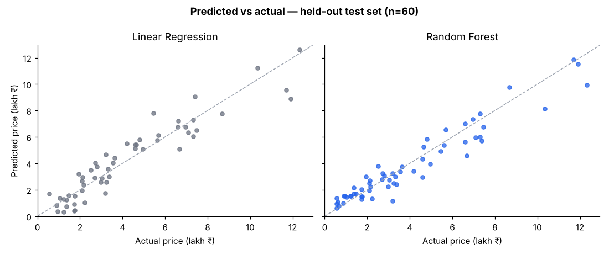
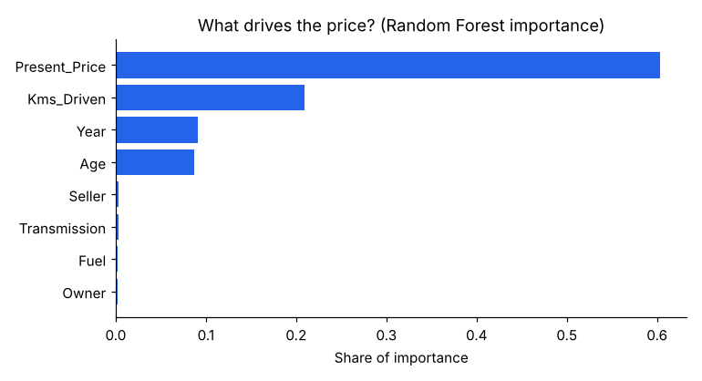
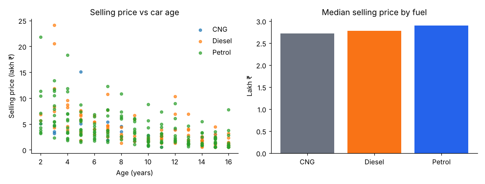
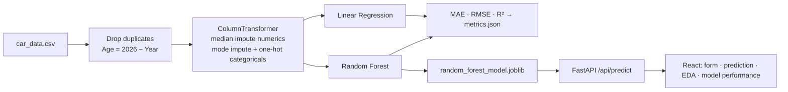

<h1 align="center">🚗 Used Car Price Estimator</h1>

<p align="center"><b>Predict a fair resale price from a car's age, original price, kilometres, fuel, transmission, seller type and ownership. A Random Forest model is served by FastAPI behind a React dashboard.</b></p>

<p align="center">
  
  
  
  
  
</p>

<p align="center"><sub>Team 12 · Darshan H N (1VA23CD025) · Likhith M (1VA23CD044) · Nikesh (1VA23CD058)</sub></p>

> [!NOTE]
> `data/car_data.csv` (300 rows) is a **synthetic educational dataset** that follows the CarDekho schema. The metrics below describe performance on that data, not on real market listings. Swap in the real CarDekho CSV and run `python backend/train_model.py` to retrain.

## Results

Held-out test split (20%, `random_state=42`, n = 60). These numbers come from the committed `metrics.json`. A fresh re-run of `backend/train_model.py` reproduced them within rounding: Linear Regression was identical, and Random Forest scored RMSE 0.862 and R² 0.9162 under scikit-learn 1.9.

| Model | MAE (lakh ₹) | RMSE (lakh ₹) | R² |
|---|---:|---:|---:|
| Linear Regression (baseline) | 0.835 | 1.047 | 0.877 |
| **Random Forest** (300 trees, depth 12) | **0.662** | **0.865** | **0.916** |

<p align="center"></p>

| What drives the price | Exploratory analysis |
|---|---|
|  |  |

The original showroom price explains about 60% of the model's decisions, followed by kilometres driven and age. Fuel, transmission, seller type and owner count add little on this dataset.

## How it works



## API

| Method | Route | Purpose |
|---|---|---|
| GET | `/api/health` | Liveness |
| GET | `/api/model-info` | Metrics for both models |
| GET | `/api/eda` | Aggregates for the EDA dashboard |
| POST | `/api/predict` | Predict price from vehicle details |

## Run locally

```bash
# Backend
cd backend
python -m venv .venv && source .venv/bin/activate   # Windows: .venv\Scripts\activate
pip install -r requirements.txt
uvicorn main:app --reload --port 8000

# Frontend (new terminal)
cd frontend
npm install
npm run dev
```

Point the frontend at the API by adding a Vite proxy for `/api` → `http://localhost:8000`. In production, `vercel.json` rewrites `/api/*` to the FastAPI service.

Re-create the charts with `python scripts/make_charts.py`.

## Project structure

```text
backend/          FastAPI app (main.py), training script, data/, ml/ (models + metrics)  ← canonical
frontend/         React + Vite single-page dashboard
ml/, data/        copies used for the course report
scripts/          make_charts.py (README figures)
docs/             charts/, flowchart, report outline
vercel.json       frontend + backend services on Vercel
```

## Limitations

- Synthetic data: retrain on real listings before trusting predictions.
- `Car_Name` (brand and model) is dropped. Adding brand as a feature would likely help on real data.
- `scikit-learn` is pinned to 1.8.x because the saved `.joblib` models were trained with it.
